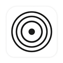

<p align="center">
  
</p>

<h1 align="center">Social Media Blocker</h1>

<p align="center">
  <strong>Break the muscle-memory tab habit. Block distracting social networks during deep work and track every impulse attempt.</strong>
</p>

<p align="center">
  
  
  
  
</p>

---

## 💡 Why Social Media Blocker?

> *"Your time is non-negotiable. Back to the focus."*

Most distractions during work or study aren't conscious decisions—they are **muscle memory**. Every time you hit a hard problem or wait 3 seconds for code to compile, your fingers automatically type `web.whatsapp.com`, `instagram.com`, or `facebook.com`.

**Social Media Blocker** intercepts that reflex at `document_start`—before the feed or messages ever load—and replaces the page with a clean, high-contrast **Focus Shield**. Even better, it counts how many times your muscle memory tried to open each platform so you can actually see your habits improve.

---

## ✨ What It Offers

- 🛑 **Instant Zero-Flash Interception:** Blocks **WhatsApp Web**, **Instagram**, and **Facebook** at `document_start` before any notifications or posts appear.
- 🎛️ **Individual Site Toggles:** Need WhatsApp Web open for a client call while keeping Instagram and Facebook locked? Toggle each platform independently from the toolbar popup.
- 📊 **Impulse Attempt Counter:** Automatically increments a local counter every time a blocked site is intercepted—showing your total blocks and a per-platform breakdown right in the Focus Panel.
- 🔒 **100% Local & Lightweight:** Built with zero external dependencies and zero background polling. Your block settings and statistics never leave `chrome.storage.local`.

---

## ⚡ Install in 60 Seconds (No Coding Required)

Works on **Google Chrome**, **Brave**, **Microsoft Edge**, **Vivaldi**, and **Opera**:

1. **Download this repository:**
   - Click the green **Code** button above and select **Download ZIP** (then extract it), *or* clone via terminal:
     ```bash
     git clone https://github.com/gabzieg/SocialMediaBlocker.git
     ```
2. **Open your browser's Extensions page:**
   - Chrome: `chrome://extensions/`
   - Brave: `brave://extensions/`
   - Edge: `edge://extensions/`
3. **Enable Developer Mode:** Toggle the **Developer mode** switch in the top-right corner.
4. **Load the Extension:** Click **Load unpacked** (top-left) and select the `SocialMediaBlocker` folder.
5. **Stay Focused:** Click the extension icon in your toolbar anytime to toggle platforms or check how many distraction impulses it caught!

---

## 🛠️ How It Works Under the Hood

| File | Role |
| :--- | :--- |
| [`manifest.json`](manifest.json) | Manifest V3 configuration registering content scripts at `document_start` across WhatsApp Web, Instagram, and Facebook. |
| [`bloqueio.js`](bloqueio.js) | Checks the active platform's toggle state in `chrome.storage.local`, increments the block counter, and replaces `document.documentElement` with the Focus Shield screen. |
| [`popup.html`](popup.html) / [`popup.js`](popup.js) | Interactive Focus Mode dashboard displaying per-platform switches and live interception statistics. |
| [`estilo.css`](estilo.css) / [`popup.css`](popup.css) | High-contrast dark UI styling for both the blocked-page shield and the toolbar popup. |

---

## 📄 License

Distributed under the **MIT License** — see [`LICENSE`](LICENSE) for details.
